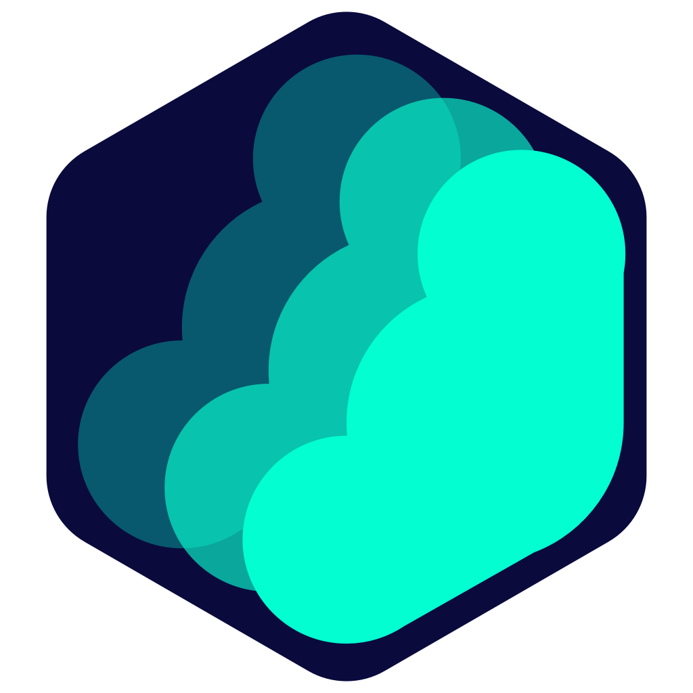
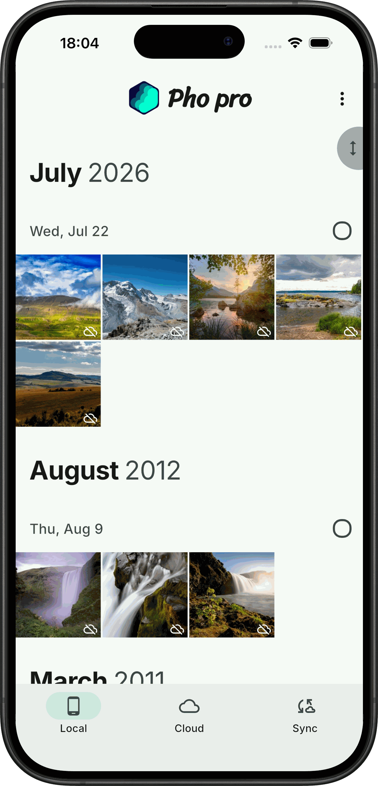
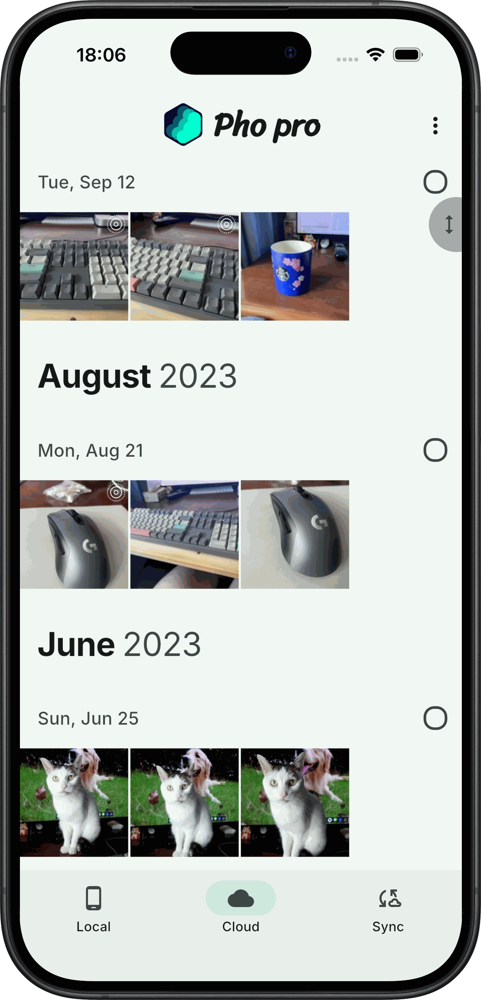
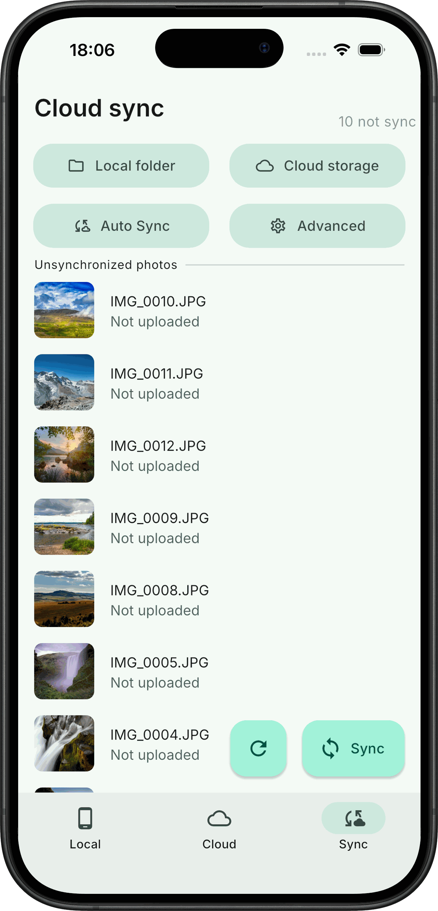
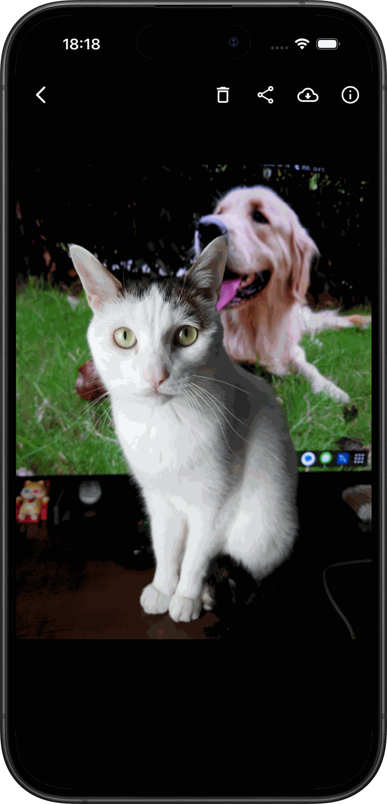

<br/><br/><p align="center">

</p>
<h3 align="center">
Pho - 一个用于查看和上传照片的无服务端应用
</h3>
<p align="center">
  
</p>
<p align="center">
  <a href="README.md">中文</a> | <a href="README_EN.md">English</a>
</p>

> **本仓库说明（fork）**：这是基于上游 [fregie/pho](https://github.com/fregie/pho)（v1.5.1）的个人自用 fork，**仅针对 iOS**，不改动连接方式与同步协议。相对上游新增三项功能：**并行上传**、**自定义上传筛选器（按类型/日期/扩展名）**、**仅相机相册（展示层）**；**不含加密功能**。完整中文改动日志见 [CHANGES-iOS.md](CHANGES-iOS.md)。本 fork 通过 GitHub Actions（macOS runner）构建**未签名 IPA**，用户用个人 Apple ID 证书自行侧载，构建方式见下文“构建”一节与 [.github/workflows/ios-build.yml](.github/workflows/ios-build.yml)。上游原作者与 GPLv3 许可证声明见文末与 [LICENSE](LICENSE)。

### 安装

**本 fork（iOS，未签名 IPA）**：
- 在本仓库 GitHub Actions 中手动触发 `ios unsigned build` 工作流（`workflow_dispatch`），下载产物 `pho-ios-unsigned-ipa` 中的 `.ipa`，用个人证书签名后侧载到自己的 iPhone（详见 [CHANGES-iOS.md](CHANGES-iOS.md) 第八节）。无开发者账号也可个人签名安装；不含推送等需开发者账号的能力。

**上游开源版**（仅 Android APK）：
- [下载 APK](https://github.com/fregie/pho/releases) — 仅含 SMB / WebDAV / NFS，无 Pro 功能

**上游 Pro 版**（含全部功能，需付费）：
- [App Store](https://apps.apple.com/cn/app/pho-%E5%90%8C%E6%AD%A5%E7%85%A7%E7%89%87%E5%88%B0nas-%E7%BD%91%E7%9B%98/id6451428709) — iOS 版，支持 AES 加密、并行上传、筛选器、百度网盘等
- [Google Play](https://play.google.com/store/apps/details?id=com.fregie.pho) — Android 版，支持 AES 加密、并行上传、筛选器、百度网盘等

> 上游开源仓库仅提供 APK 下载。iOS 用户请前往 App Store、Android 用户请前往 Google Play 下载 Pro 版（支持免费试用基础功能后购买 Pro）。本 fork 与上游 Pro 版无关，不提供付费功能解锁。

### 介绍
该应用的目的是替代手机上的自带相册应用,并且能够将照片同步到网络储存.  
功能简单,只是用于查看照片以及同步照片到网络储存.试图做到优秀的体验.

### 功能
* 本地照片查看
* 云端照片查看
* 增量同步照片到云端
* 后台定期同步
* 无数据库,无服务端
* 以时间组织云端存储的目录结构
* 并行上传（本 fork 新增，仅 iOS：上传并发数 1–4 可调，后台同步封顶为 2）
* 自定义上传筛选器（本 fork 新增，仅 iOS：按类型、日期范围、扩展名排除不上传的照片）
* 仅相机相册（本 fork 新增，仅 iOS：相册展示时只显示相机拍摄的照片，同步不受影响）

### 支持的网络储存
- [x] Samba
- [x] Webdav
- [x] NFS
- [ ] 阿里网盘
- [ ] oneDrive
- [ ] google drive
- [ ] google photo

### 与 Pro 版本差异
本仓库为 Pho 开源版,仅包含核心的照片查看与同步功能.以下功能仅在 Pro 版本中提供(未开源)，**除已标注“本 fork 已实现”的项外**：

- AES 加密上传(支持 AES-128-CFB 与 AES-256-GCM,加密视频支持 Range 播放)——本 fork **未实现**，不含加密功能
- 并行上传调优(多文件并发上传)——**本 fork 已实现**（仅 iOS，见上文“功能”）
- 文件筛选器(按类型/日期等条件过滤同步)——**本 fork 已实现**（仅 iOS，见上文“功能”）
- 仅相机相册——**本 fork 已实现**（仅 iOS，展示层过滤，见上文“功能”）
- 目录结构配置(可选 `YYYY/MM/DD` 或 `YYYYMMDD` 组织方式)——本 fork 未实现
- 主题色自定义——本 fork 未实现
- 百度网盘支持——本 fork 未实现

开源版仅支持 Samba / WebDAV / NFS 三种网络储存.

Pro 版在 App Store 和 Google Play 提供： [App Store](https://apps.apple.com/cn/app/id6451428709) / [Google Play](https://play.google.com/store/apps/details?id=com.fregie.pho)

### 截图
<p align="left">




</p>

### 路线图
- [x] 支持放大/缩小图片
- [x] 支持上传/浏览视频
- [x] 支持NFS
- [x] 支持IOS端
- [ ] 支持desktop端
- [x] 支持中文

### 构建
#### 环境要求
- Flutter: 3.47.9 (stable), Dart: 3.13.7
- Go: 1.25 (toolchain go1.25.4)
- JDK: 17
- Android SDK: compileSdk 36
- Android NDK: 用于构建嵌入式 Go 服务端 (gomobile bind)
- protoc + 插件: protoc-gen-go@v1.27.1, protoc-gen-go-grpc@v1.1.0, protoc_plugin@21.1.2 (Dart)
- macOS + Xcode: 仅构建 iOS 时需要（本 fork 的未签名 IPA 在 GitHub Actions 的 macOS runner 上构建，见下）

#### 构建步骤
```bash
# 1. 生成 protobuf 代码 (Go + Dart stubs)
make prebuild      # 安装 protoc 插件
make protobuf

# 2. 构建嵌入式 Go 服务端
make server-aar     # Android: android/app/libs/server.aar (需 gomobile)
make server-ios     # iOS: ios/Frameworks/RUN.xcframework
make server-linux   # Linux: linux/lib/run.so
make server-windows # Windows: windows/lib/run.dll

# 3. 构建 Flutter 应用
make apk           # Android APK
make ipa           # iOS IPA（开发签名导出，需个人 Team）

# 4. 运行测试 (需要 Docker 用于 SMB/WebDAV/NFS 测试容器)
make test
```

#### iOS 未签名包（本 fork）
```bash
# 本地 macOS：
make server-ios
flutter pub get
flutter build ios --release --no-codesign
# 再把 build/ios/iphoneos/Runner.app 打包进 Payload/ 目录生成 .ipa

# 云端构建：推送代码后，在 GitHub Actions 中手动触发
# `ios unsigned build` 工作流（workflow_dispatch），产物为
# pho-ios-unsigned-ipa（含未签名 .ipa），下载后用个人证书签名侧载。
# 工作流定义见 .github/workflows/ios-build.yml。
```

> 注: `flutter run` 不会自动构建 `android/app/libs/server.aar`,需先执行 `make server-aar`,否则 Go 服务端无法启动.同理，`flutter build ios` 之前须先执行 `make server-ios` 生成 `ios/Frameworks/RUN.xcframework`，否则 iOS 构建会缺 server 绑定而失败。

### 参与贡献
感谢各位的积极反馈

给本项目提需求的还不少,但是我一个人精力有限,如果你有兴趣,欢迎加入.

可以在issue中回复沟通,帮忙一起做一些功能,提出你的pull request.

### 文件储存逻辑
本着尽可能简单的逻辑来储存文件,以时间为目录结构,以文件名为文件名储存源文件.在根目录创建一个`.thumbnail`目录来储存生成的缩略图,缩略图的目录结构与源文件相同.  
你可以随时以其他形式利用你备份上去的照片,而不用依赖此app.
目录结构示意图:
```bash
├── 2022
│   ├── 07
│   │   ├── 02
│   │   │   ├── 20220702_100940.JPG
│   │   │   ├── 20220702_111416.JPG
│   │   │   └── 20220702_111508.JPG
│   │   └── 03
│   │       ├── 20220703_101923.DNG
│   │       ├── 20220703_112336.DNG
│   │       └── 20220703_112338.DNG
├── 2023
│   └── 01
│       └── 03
│           ├── 20230103_112348.JPG
│           ├── 20230103_124634.JPG
│           └── 20230103_124918.DNG
└── .thumbnail
     └── 2022
         └── 07
             ├── 02
             │   ├── 20220702_100940.JPG
             │   ├── 20220702_111416.JPG
             │   └── 20220702_111508.JPG
             └── 03
                 ├── 20220703_101923.DNG
                 ├── 20220703_112336.DNG
                 └── 20220703_112338.DNG
```

### 许可证与来源
本项目基于上游 [fregie/pho](https://github.com/fregie/pho)，遵循 GPLv3 许可证，许可证全文见 [LICENSE](LICENSE)。上游作者 fregie 保留其原作权利；本 fork 的改动内容与中文改动日志见 [CHANGES-iOS.md](CHANGES-iOS.md)。

### Star History

[](https://star-history.com/#fregie/pho&Date)
